<a href="https://prashx1908.github.io/devPrash/">Portfolio</a> ·
<a href="https://www.linkedin.com/in/prashanth-g-399225202">LinkedIn</a> ·
<a href="mailto:prashanth.dev1908@gmail.com">Email</a>

